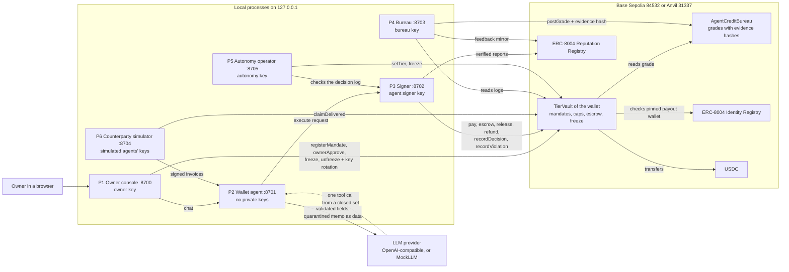

# Agent Credit Bureau

A credit bureau for AI agents, and an AI wallet agent that earns its own autonomy on-chain.

Entry of Team Mongolia (National University of Mongolia) for FinTechathon 2026, the 2026 Shenzhen
International FinTech Competition (WeBank FinTech College Students Challenge), International AI Track,
Topic F "Agent Wallet - Autonomous On-chain Wallet".

> "Before an AI wallet pays another AI agent, it checks that agent's credit grade, which anyone can
> recompute from the chain; and the wallet's own permissions are earned the same way and can be lost in
> one transaction."

This README follows the seven sections of the official source code README template.

### For judges: verify in 3 minutes

| What | Where |
|---|---|
| Headline transactions of the recorded Base Sepolia run (one per claim, explorer links) | [evidence/base_sepolia/HEADLINE.md](evidence/base_sepolia/HEADLINE.md) |
| Execution evidence with the measured results (steps passed, attack-suite totals, grades, gas) | [docs/deliverables/out/execution-evidence.md](docs/deliverables/out/execution-evidence.md) |
| Demo video (4:57, English narration and burned-in subtitles) | [video/InternationalAI-TeamMongolia-DemoVideo.mp4](video/InternationalAI-TeamMongolia-DemoVideo.mp4), subtitles in [video/InternationalAI-TeamMongolia-DemoVideo.srt](video/InternationalAI-TeamMongolia-DemoVideo.srt) |
| Presentation deck | [deck/InternationalAI-TeamMongolia-Deck.pptx](deck/InternationalAI-TeamMongolia-Deck.pptx) (PDF copy: [deck/InternationalAI-TeamMongolia-Deck.pdf](deck/InternationalAI-TeamMongolia-Deck.pdf)) |
| Technical document, security self-assessment, execution evidence, model card (PDF) | [docs/deliverables/pdf/](docs/deliverables/pdf/) (rendered from [docs/deliverables/out/](docs/deliverables/out/) by `scripts/export_pdfs.py`) |
| Contract addresses and roles | [deployments/base_sepolia.json](deployments/base_sepolia.json) |

One command checks every transaction of the run against its saved receipt. It needs only Python, no
install and no network:

```bash
python scripts/verify_evidence.py evidence/base_sepolia/evidence.json --receipts-only
```

Drop `--receipts-only` to fetch each receipt from a Base Sepolia RPC as well, and see section 6.2 to
recompute a grade from public data. This README does not type any measured number: every count, hash and
metric comes from the evidence files and appears in the rendered documents above.

---

## 1. Project Overview

- **Track:** International AI Track, Topic F "Agent Wallet - Autonomous On-chain Wallet"
- **Team name:** Team Mongolia (National University of Mongolia)
- **Project name:** Agent Credit Bureau (ACB)
- **One-line summary:** an autonomous USDC wallet agent on Base that pays other AI agents only within
  owner mandates registered on-chain, decides how to pay from each counterparty's recomputable credit
  grade, and moves up and down permission tiers enforced by its own vault contract.

### The pitch

AI agents are starting to pay each other, but an agent that receives a payment request has no way to
know how the other agent has behaved before. Known incidents show the two failure modes: an LLM that held
the transfer decision and was talked into it (Freysa, Nov 2024, about 13.19 ETH; OECD AI incident
[2024-11-29-2e31](https://oecd.ai/en/incidents/2024-11-29-2e31)), and a Morse-code prompt injection
combined with privilege escalation through a gifted NFT (Grok / Bankrbot, May 2026; OECD AI incident
[2026-05-04-4a73](https://oecd.ai/en/incidents/2026-05-04-4a73)). Agent Credit Bureau answers both. A
bureau grades every agent registered on ERC-8004 (a **Draft** Ethereum standard for agent identity and
reputation) as A, B, C, D, or NEW. It uses only settlement records in registered vaults (escrow outcomes
from the provider's own on-chain claim; direct-pay outcomes that buyers record on-chain, where only buyers
in good standing carry adverse weight),
each backed by an invoice signed by the payee's registered wallet, and verified reports backed by evidence
signed by the graded agent itself (injection attempts, spam, bad data). Praise and unverified accusations
carry no weight. Each grade is posted with a model id, a config hash and an evidence hash, and
`acb bureau recompute` reproduces it from public data. Our wallet agent reads those
grades before it pays: grade A is paid directly, grade B is capped, new or unrated agents go through
escrow, grade D is refused. The wallet's own permissions follow the same idea with bank-style controls:
it starts at a small-payments tier, earns promotion one tier at a time from a clean record, is demoted or
frozen (circuit breaker) by its own violations in the same transaction, and only the human owner can
unfreeze it and rotate its key. The LLM only selects actions; it never signs and never sees a key, and it
sees counterparty text only as quarantined invoice data, never as messages.

### Team

| Member | Role | Major |
|---|---|---|
| Taivanbat Bayarsaikhan | Team leader | Computer Science, National University of Mongolia |
| Tuguldur Munkhbat | Member | Software Engineering, National University of Mongolia |

Both members graduate in winter 2026.

### What the wallet does (Topic F)

| Topic F word | Feature |
|---|---|
| Asset management | Vault balance, a reserve floor the agent cannot spend, on-chain mandate budgets, a rolling 24 h window cap, escrow-locked funds, single-name exposure limits per payee, status and "why" answers in chat |
| Transaction execution | Autonomous pay, capped pay (reduced quantity), escrow, release after the provider's on-chain delivery claim, refund, owner-approved execution (maker-checker); every transaction is signed by a separate signer process |
| Risk control | Counterparty grades from the bureau; a deterministic policy engine with adverse-action reason codes; invoice validation and provenance rules; an injection detector; on-chain mandates, caps and grade masks; Earned Autonomy (promotion, demotion, freeze, human reset with key rotation) |

### What is new, and what is not

"An agent trust score that gates spending" is not new (related work in the technical document). Our
narrower claim:

1. Grades come only from settlement records in registered vaults (escrow outcomes from the provider's
   own on-chain claim, direct-pay outcomes recorded by buyers, with adverse weight only for buyers in good
   standing) and from evidence signed by the graded agent itself (verified injection, spam and bad-data
   reports); praise and unverified accusations carry no weight.
2. Every grade carries a model id, config hash and evidence hash and recomputes to `MATCH` from public data.
3. Reporter weighting and the scorecard are attacked by our own suite (sybil reports, dust self-trading,
   wash rings, fake vaults, smears) and backtested on synthetic populations.
4. The wallet's own autonomy is earned and lost on-chain from its own record, with maker-checker,
   circuit breaker, adverse-action style reason codes, appeals and model change control.

### The owner dialogue (step S5 of the recorded run)

The owner talks to the wallet in plain language; code, not the LLM, decides what is safe. The scripted
owner lines of the recorded run (`config/scenario.yaml`, `dialogue`):

1. Intent: "I need FX market data and API calls for my research today, budget 5 USDC". The agent drafts
   a mandate; code cannot resolve "FX data" and "API calls" to one pinned payee each, so it forces a
   clarification and the agent asks which providers to use.
2. Answer: "Use all five: Atlas, Slowpoke, Nova, Orion, and Ghost as a backup". Code resolves the names
   against the pinned directory.
3. Correction: "Actually make the total 4 USDC, not 5". The agent updates the draft; the owner confirms
   a card that the console rebuilds from chain reads and registers mandate M1 on-chain.

The agent's actual replies and cards are recorded in
[evidence/base_sepolia/dialogue/S5.json](evidence/base_sepolia/dialogue/S5.json), with a
[Blockscout page of the mandate's registration](evidence/base_sepolia/screenshots/s05-register-mandate-blockscout.png); the dialogue
evaluation with a real LLM (ambiguous requests, corrections, requests in Chinese, hostile requests) is
reported in the [technical document](docs/deliverables/out/technical-document.md). If the LLM is unreachable, the agent
switches to a rule-based parser and the console shows "AI offline: rule-based mode" (reason 2300); the
policy engine and the signer never need the LLM.

### On-chain exploration

- The **official ERC-8004 registries** on Base Sepolia (a Draft standard): our agents register
  identities and payout wallets there, and the bureau mirrors grades and verified reports as feedback.
  Their implementation addresses are pinned and checked before every run.
- A **grade registry** contract: each grade carries a model id, a config hash, an evidence hash, an
  evidence URI and reason codes; upgrades take effect after an on-chain delay, downgrades at once.
- **Permissionless recompute**: anyone can rebuild a posted grade from chain logs and the hash-checked
  public evidence files (`acb bureau recompute`, section 6.2).
- An **on-chain autonomy state machine** in the wallet's own vault: promotion one tier at a time,
  demotion and freeze in the same transaction as the violation, owner-only unfreeze with key rotation.
- **Contract-enforced grade masks**: the vault reads the payee's grade at payment time and reverts a
  payment the payee's grade does not allow, whatever the agent proposed.
- **Verified sources**: after deployment our contract sources are verified on Blockscout (section 6.1);
  the Blockscout address links in the [execution evidence](docs/deliverables/out/execution-evidence.md)
  open them.
- A static, read-only **grade lookup page** (`site/bureau.html`) that reads the bureau contract on Base
  Sepolia (testnet) from the browser.

### Deliverables

The sources of the written deliverables are in `docs/deliverables/`. Measured values (transaction
hashes, counts, attack totals, metrics) are placeholders in the sources and are filled from the evidence
files by `scripts/render_deliverables.py`; reviewers read the rendered copies in `docs/deliverables/out/`.

| Deliverable | Source | Rendered |
|---|---|---|
| Technical document | [docs/deliverables/technical-document.md](docs/deliverables/technical-document.md) | [out/technical-document.md](docs/deliverables/out/technical-document.md) |
| Security self-assessment | [docs/deliverables/security-self-assessment.md](docs/deliverables/security-self-assessment.md) | [out/security-self-assessment.md](docs/deliverables/out/security-self-assessment.md) |
| Execution evidence | [docs/deliverables/execution-evidence.md](docs/deliverables/execution-evidence.md) | [out/execution-evidence.md](docs/deliverables/out/execution-evidence.md) |
| Presentation deck: final slides on the official template | [docs/deliverables/deck.md](docs/deliverables/deck.md) (slide content) | [deck/InternationalAI-TeamMongolia-Deck.pptx](deck/InternationalAI-TeamMongolia-Deck.pptx), PDF copy [deck/InternationalAI-TeamMongolia-Deck.pdf](deck/InternationalAI-TeamMongolia-Deck.pdf); content with measured values in [out/deck.md](docs/deliverables/out/deck.md) |
| Model card of the scorecard `acb-sc-1.0.0` | [docs/deliverables/model-card.md](docs/deliverables/model-card.md) | [out/model-card.md](docs/deliverables/out/model-card.md) |
| Placeholder registry (where every measured value comes from) | [docs/deliverables/placeholders.md](docs/deliverables/placeholders.md) | - |
| Headline transactions of the recorded run | [evidence/base_sepolia/HEADLINE.md](evidence/base_sepolia/HEADLINE.md) | - |
| Demo video (submitted separately) | `InternationalAI-TeamMongolia-DemoVideo.mp4` | - |
| Build specification (design, threat model, test plan) | [docs/design/spec.md](docs/design/spec.md) | - |

---

## 2. System Architecture

### Components

Six local services on `127.0.0.1` (P1-P6), a local chain for development (P0), a one-shot scenario
runner (P7), and the contracts below. Each process holds only its own secret, so the
party that talks to the LLM holds no key, the party that grades is not the party that promotes, and the
party that signs re-checks everything on fresh chain state.



| # | Process (command) | Port | Secret it holds | Role |
|---|---|---|---|---|
| P0 | Local chain (`acb chain up`, Anvil) | 8545 | - | Local development chain |
| P1 | Owner console (`acb owner serve`) | 8700 | Owner key, console password | Chat, live panels, owner transactions; rebuilds every confirmation screen from chain reads |
| P2 | Wallet agent (`acb agent serve`) | 8701 | LLM API key, service tokens; **no private keys** | Dialogue, invoice validation, quarantine, policy (first pass) |
| P3 | Signer (`acb signer serve`) | 8702 | Agent signer key | Re-validates and re-runs the policy on fresh state, classifies violations, logs the decision, signs whitelisted vault calls |
| P4 | Bureau (`acb bureau serve`) | 8703 | Bureau key | Indexer, scorecard, evidence bundles, grade posting, ERC-8004 mirror |
| P5 | Autonomy operator (`acb autonomy serve`) | 8705 | Autonomy key | Promotions within on-chain bounds; freezes on any outflow without a signer decision |
| P6 | Counterparty simulator (`acb sim serve`) | 8704 | Simulated agents' keys | Providers (Atlas, Slowpoke, Ghost, Blaster, Orion, Nova), the Beacon buyer, Echo identities, an attacker |
| P7 | Scenario runner (`acb scenario run`) | - | Run tokens, owner key; the deployer and admin keys only in the deploy steps (S1 deployment and `setPoster`, S3 funding); the agent key only for the "stolen key" steps | Drives the recorded run S0-S21 and writes the evidence |

The ACB admin key is held by no service: only the deploy steps (`acb deploy` and the scenario's S1) use it.

| Contract | Source | Purpose |
|---|---|---|
| `AgentCreditBureau` | `contracts/src/AgentCreditBureau.sol` | Latest grade per agent with model id, config hash, evidence hash and reason codes; grade upgrades take effect after an on-chain delay, downgrades at once; refuses self-grading; registers vaults by code hash and configuration; appeals |
| `TierVault` | `contracts/src/TierVault.sol` | Holds the wallet's USDC. Enforces owner mandates (payees, pinned payout wallets, per-tx and total budget, expiry), tier caps, grade masks, reserve floor, replay protection, escrow with provider delivery claims, maker-checker approvals, and the on-chain autonomy state machine (promotion, demotion, freeze, owner unfreeze with key rotation) |
| ERC-8004 Identity and Reputation | Official registries on Base Sepolia; `contracts/src/erc8004/*Lite.sol` on Anvil | Agent identities and payout wallets; grade mirror and verified reports as feedback. ERC-8004 is a **Draft** standard |
| `MockUSDC` | `contracts/src/MockUSDC.sol` | Test token on Anvil only; Base Sepolia uses Circle test USDC |

### One payment, end to end

1. The owner states an intent in chat; the LLM drafts a mandate; code resolves payee names against a
   pinned directory and forces a clarification when a name is ambiguous.
2. The owner confirms on a card that P1 builds from chain reads (payout wallet, grade, registration age)
   and registers the mandate on-chain with the owner key.
3. The agent requests quotes from mandated payees, each with a single-use quote request id.
4. A provider returns an invoice signed by its registered wallet. Code validates it (checks V01-V09)
   before any LLM sees it; an unsolicited invoice is dropped without an LLM turn.
5. The LLM receives validated fields and the memo as quarantined data, and picks one tool:
   `decide_invoice` with an action and the restated payee and amount.
6. The deterministic policy engine computes the decision and its reason codes (for example 2000 "Paid:
   grade A counterparty within tier limits", 2004 "Escrow required: counterparty is new or unrated",
   2100 "Refused: counterparty grade D").
7. The signer re-reads the chain, re-validates, re-runs the policy, records any violation first, logs the
   decision, simulates and sends. The vault enforces the mandate, caps and grade on-chain and pays only
   the pinned payout wallet.
8. Delivery is recorded on-chain (escrow: the provider's own claim; direct pay: the signed receipt timed
   by the buyer). The bureau later scores these outcomes.

### Core algorithms

- **Credit scorecard `acb-sc-1.0.0`** (`src/acb/bureau/models/sc_1_0_0.py`, `config/scorecard.yaml`):
  an additive points scorecard, integer arithmetic only. Base 600, clamped to 300-850; bands A >= 700,
  B >= 640, C >= 560, else D. Rules applied in order: hard injection flag -> D; cold start (fewer than 3
  settled orders) -> NEW, C or D; circular-volume cap; a standing gate (no A or B without trade with an
  agent in good standing, the bound on sybil rings); an age gate for A. Every grade carries 1-4
  reason codes in the style of adverse-action notices, for example 1100 "No adverse factors" or 1101
  "Not enough history yet: treated as new" (`src/acb/reason_codes.py`). Model governance and validation are in the
  [model card](docs/deliverables/model-card.md).
- **Earned Autonomy** (`config/tiers.yaml`, enforced in `TierVault`): see the tier table in section 7.
  Promotion is at most one tier per cooldown, needs a clean record and never goes above `maxAutoTier`
  (2); a serious violation demotes one tier and a severe one freezes the vault in the same transaction.
- **Policy engine `acb-pol-1.0.0`** (`src/acb/policy/`, `config/policy.yaml`): invoice validation
  V01-V09, then checks C01-C18 over the vault's on-chain masks; deterministic, with a golden decision
  table in `tests/policy/golden_decisions.csv`.
- **Wallet agent** (`src/acb/agent/`): Action-Selector design with echo-and-verify. Owner turns and
  invoice turns have different closed tool sets; arguments are validated strictly and re-derived by
  code. A rule-based fallback parser takes over when the LLM is unavailable (reason 2300).

---

## 3. Environment and Dependencies

- **Operating system:** developed and tested on Windows 11; the same commands run on Linux and macOS.
- **Runtime versions:** Python 3.12 (`.python-version`; `pyproject.toml` allows >=3.12,<3.14), uv,
  Foundry (forge, anvil, cast; tested with 1.8.5), Solidity 0.8.30 with `evm_version = "cancun"` and
  `via_ir = true` (`foundry.toml`; forge downloads solc on the first build).
- **Main dependencies:** web3 7, eth-account, pydantic 2, httpx, openai (OpenAI-compatible client),
  FastAPI and uvicorn, rich, python-dotenv, PyYAML (`pyproject.toml`, pinned in `uv.lock`); pytest and
  ruff for development; forge-std vendored in `contracts/lib/forge-std`. The owner console is plain
  JavaScript with no build step and no CDN. `scripts/verify_evidence.py` uses only the Python standard
  library.
- **Environment variables:** never commit real secrets or sensitive data. `.env` is git-ignored; the
  committed template is [.env.example](.env.example). **A local Anvil run needs no keys at all**: every
  role key is derived from Anvil's public test mnemonic.

| Group | Variables | Notes |
|---|---|---|
| Network | `NETWORK`, `ANVIL_RPC_URL`, `BASE_SEPOLIA_RPC_URL`, `BASE_SEPOLIA_RPC_URL_2`, `EVIDENCE_BASE_URI`, `ACB_FOUNDRY_BIN`, `ACB_OUT_DIR` | Defaults work for Anvil. `ACB_FOUNDRY_BIN` defaults to `~/.foundry/bin` (`%USERPROFILE%\.foundry\bin` on Windows), then `PATH` |
| Role keys | `ACB_MNEMONIC`, `DEPLOYER_PRIVATE_KEY`, `OWNER_PRIVATE_KEY`, `ADMIN_PRIVATE_KEY`, `AGENT_SIGNER_PRIVATE_KEY`, `AGENT_SIGNER_NEXT_PRIVATE_KEY`, `BUREAU_PRIVATE_KEY`, `AUTONOMY_PRIVATE_KEY`, `SIM_*_PRIVATE_KEY` | Leave empty on Anvil. For Base Sepolia, `acb keys init` fills them (section 4.6) |
| Service tokens | `SIGNER_TOKEN`, `AGENT_TOKEN`, `AGENT_ADMIN_TOKEN`, `BUREAU_TOKEN`, `AUTONOMY_TOKEN`, `SIM_TOKEN`, `EVENTS_TOKEN`, `OWNER_UI_PASSWORD`, `SESSION_SECRET` | Random values. The scenario and the suites make fresh ones per run; the interactive commands read them from `.env` (`acb up`; `acb chat` and the owner CLI also take `--env-file`). `OWNER_UI_PASSWORD` needs at least 8 characters and `SESSION_SECRET` at least 16 |
| LLM | `LLM_MODE`, `LLM_BASE_URL`, `LLM_MODEL`, `LLM_API_KEY` (or `OPENAI_API_KEY`), `LLM_TIMEOUT_S`, `LLM_TOOL_MODE`, `LLM_EXTRA_BODY`, `MOCK_LLM_SCRIPT`, `MOCK_LLM_PERSONA`, `ACB_ALLOW_LLM_SWITCH` | See section 4.5 |
| Ports | `OWNER_PORT` 8700, `AGENT_PORT` 8701, `SIGNER_PORT` 8702, `BUREAU_PORT` 8703, `SIM_PORT` 8704, `AUTONOMY_PORT` 8705 | All services bind to `127.0.0.1` only |

The launcher gives each service only the variables allow-listed for it in `config/processes.yaml`, and the
wallet agent exits if any `*_PRIVATE_KEY` or `*_MNEMONIC` variable is visible to it.

---

## 4. Installation and Execution

### 4.1 Install the tools (clean machine)

**Windows (PowerShell)**

```powershell
# uv (Python package and project manager; installs Python 3.12 for this project on demand)
powershell -ExecutionPolicy ByPass -c "irm https://astral.sh/uv/install.ps1 | iex"
# Git for Windows, if missing
winget install --id Git.Git -e
```

Foundry on Windows: open **Git Bash** and run

```bash
curl -L https://foundry.paradigm.xyz | bash
# open a new Git Bash window, then:
foundryup
```

The binaries land in `%USERPROFILE%\.foundry\bin`. The `acb` commands find them there without any `PATH`
change; for running `forge` yourself in PowerShell, add the folder to `PATH` for the session:

```powershell
$env:PATH = "$env:USERPROFILE\.foundry\bin;$env:PATH"
```

**Linux / macOS (bash or zsh)**

```bash
curl -LsSf https://astral.sh/uv/install.sh | sh
curl -L https://foundry.paradigm.xyz | bash
# open a new shell, then:
foundryup
```

### 4.2 Get the code and install the Python environment

```bash
git clone https://github.com/taivnaaiwnl/shenzhen-comp.git
cd shenzhen-comp
uv sync                 # creates .venv from uv.lock (runtime + pytest and ruff)
uv run acb --help       # lists every command
```

The contracts are deployed from the committed ABI and bytecode artefacts in `abi/`, so Foundry is needed
only for Anvil and the forge tests. After changing a contract, rebuild the artefacts with
`uv run python scripts/export_abi.py`.

### 4.3 Quick start A: the whole recorded scenario on a local chain (no keys, no network)

```bash
uv run acb scenario run --network anvil
```

This starts a fresh Anvil node and all six services on free ports with fresh tokens, deploys the
contracts, registers the agents, and runs the 22 steps S0-S21 of the recorded run with the deterministic
MockLLM: warm-up trading and grading, the owner dialogue and mandate, autonomous pay, capped pay, escrow,
promotion, a provider default and grade collapse, on-chain refusals, stolen-key reverts, an injection
that demotes the wallet, a drain attempt that freezes it, the owner's key rotation and unfreeze, a
maker-checker approval, spam drop, an appeal, and a final recompute and verification. Each step prints
human log lines and ends PASSED or FAILED; the command exits 0 only when every step passed.

Useful options (all from `acb scenario run --help`):

| Option | Effect |
|---|---|
| `--llm mock\|openai\|auto` | LLM for owner dialogue and careful invoice turns (default `mock` on Anvil). With a real LLM the runner asserts that the signer outcome is at least as strict as expected |
| `--from S6 --to S12 --run-id <id> --keep` | Run a range or resume a kept run |
| `--fixed-ports` | Use ports 8700-8705 instead of free ports |
| `--no-owner-ui` | Do not start the owner console |
| `--fresh-build` | Step S0 also runs `forge build` and compares the vault code hash with `abi/` |

Output goes to `runs/<run_id>/out/anvil/` (git-ignored). To export and check it locally:

```bash
uv run acb evidence export --network anvil --run-id <run_id> --dest runs/<run_id>/evidence
uv run acb evidence verify runs/<run_id>/evidence/evidence.json --network anvil --receipts-only
```

### 4.4 Quick start B: the owner console, interactively

1. Create `.env` from the template and fill the nine service-token lines (`SIGNER_TOKEN` to
   `SESSION_SECRET`) with random values. Print values to paste with:

   ```bash
   uv run python -c "import secrets; [print(secrets.token_hex(24)) for _ in range(9)]"
   ```

   Copy the template with `cp .env.example .env` (Linux/macOS) or `Copy-Item .env.example .env`
   (PowerShell), then edit `.env` in a text editor. Leave every key line empty: on Anvil the services
   use the public Anvil test keys, and a key set in `.env` would take precedence for the owner console.

2. Start a chain, deploy, and start the services:

   ```bash
   uv run acb chain up --block-time 1
   uv run acb deploy all --network anvil
   uv run acb up --network anvil
   ```

3. Open the owner console at **http://127.0.0.1:8700** and sign in with `OWNER_UI_PASSWORD`. Try for
   example "I need FX market data and API calls for my research today, budget 5 USDC". The agent drafts
   a mandate and asks you to pick payees; the confirmation card is built from the chain, and Confirm
   sends `registerMandate` with the owner key. The right-hand panels show the wallet tier and limits,
   counterparty grades with reason codes, the decision log, the autonomy timeline and counterparty
   messages.

   On a fresh deployment every agent is still ungraded, so purchases go to escrow. Quick start A shows
   the full story with grades.

4. A terminal fallback for the same chat: `uv run acb chat` (cards are confirmed by typing their codes).
   Owner actions also exist as commands: `uv run acb owner status | freeze | unfreeze --to 0|1
   [--rotate-to <address>] | approve <orderId> | revoke <mandateId>`.

5. Stop everything:

   ```bash
   uv run acb down --network anvil
   uv run acb chain down
   ```

### 4.5 Switching the LLM provider

The wallet agent talks to any OpenAI-compatible endpoint (`src/acb/agent/llm.py`). Set these in `.env`:

| Setting | OpenAI (default) | DeepSeek (untested, see below) | No LLM |
|---|---|---|---|
| `LLM_MODE` | `auto` | `auto` | `mock` |
| `LLM_BASE_URL` | empty (becomes `https://api.openai.com/v1`) | `https://api.deepseek.com` | - |
| `LLM_MODEL` | empty (becomes `gpt-5.4-mini`) | a model id from DeepSeek's model list | - |
| `LLM_API_KEY` | your key (or set `OPENAI_API_KEY` instead) | your DeepSeek key | - |

- The DeepSeek column is a configuration only. We have not yet run a tool-call test against DeepSeek,
  and we have not tested whether it is reachable from mainland China; treat it as untested until a
  dialogue evaluation with it is published in `evidence/`.
- `LLM_MODE=auto` uses the real provider when a key is set and MockLLM otherwise.
- `OPENAI_API_KEY` is only ever sent to `https://api.openai.com`: the host is parsed, so a DeepSeek or
  any other base URL never receives it (`src/acb/config.py`).
- If a provider rejects `tool_choice="required"` (HTTP 400), the client retries with `"auto"`, then falls
  back to JSON mode; `LLM_TOOL_MODE=json` uses JSON mode from the start. `LLM_EXTRA_BODY` passes a JSON
  object of provider options (for example to turn a thinking mode off).
- If the LLM times out or fails, the agent switches to the rule-based parser, marks decisions with
  reason 2300 and shows "AI offline: rule-based mode" in the console. The policy engine and the signer
  never need the LLM.

### 4.6 Running on Base Sepolia (testnet)

1. Put a testnet-only mnemonic in `.env` once, quoted: `ACB_MNEMONIC="..."`. Then run
   `uv run acb keys init --network base_sepolia`. It derives the hot keys, generates the owner and admin
   keys independently, fills empty service tokens, writes the keys into `.env`, removes the mnemonic
   line, and prints only addresses and the funding plan.
2. Fund the printed deployer address from Base Sepolia faucets (test ETH and Circle test USDC); check
   with `uv run acb keys balances --network base_sepolia`.
3. Run the recorded scenario. Without `--yes` only the read-only S0 preflight runs:

   ```bash
   uv run acb scenario run --network base_sepolia --llm auto --yes
   uv run acb evidence export --network base_sepolia --run-id <run_id>
   uv run acb evidence verify --network base_sepolia
   ```

`acb deploy all --network base_sepolia --yes` deploys without running the scenario. The pinned
ERC-8004 registry and USDC addresses, the chunked log reads (the public RPC limits `eth_getLogs` to 200
blocks) and the funding plan are in `config/networks.yaml`.

---

## 5. Testing

### 5.1 Commands

| What | Command | Expected result |
|---|---|---|
| Contract build and size | `forge build --sizes` | Builds; `TierVault` runtime code under the 24,576-byte limit |
| Contract tests (unit, fuzz, invariant) | `forge test -vv` | All pass. Fuzz and invariant runs 512, invariant depth 64 (`foundry.toml`) |
| Invariants only | `forge test --match-contract Invariant -vvv` | All pass |
| Python tests, fast | `uv run pytest -m "not llm and not slow"` | All pass. Tests marked `chain` start their own Anvil on a free port and skip with a message when Anvil is missing |
| Python tests, everything without a real LLM | `uv run pytest -m "not llm"` | All pass, including the full scenario, the attack suite and the benign suite on Anvil |
| Lint | `uv run ruff check .` | No findings |
| Counted attack suite (A01-A63) | `uv run acb attacks run --network anvil` | Every attack classified Blocked, Contained, Bounded or Escalated; target 0 Failed. `--only A01,A05` runs a subset; `--export` writes `evidence/attack_suite.json` |
| Benign suite (B01-B14) | `uv run acb attacks benign --network anvil` | Target: at most 1 false positive of 14. `--export` writes `evidence/benign_suite.json` |
| Scorecard backtest | `uv run acb bureau backtest` | Deterministic for a seed (defaults: 300 agents, 6 rounds, seed 2026); writes `backtest.json` to `ACB_OUT_DIR` or `--out` |
| Dialogue evaluation with a real LLM | `uv run pytest -m llm tests/llm` | Needs an LLM key; set `ACB_DIALOGUE_EVAL_OUT=evidence/dialogue_eval.json` to keep the result |
| Full recorded scenario | `uv run acb scenario run --network anvil` | Every step S0-S21 PASSED; exit code 0 |

Run the `forge` commands from the repository root (Windows: add Foundry to `PATH` as in section 4.1).

### 5.2 What the tests cover

- **Contracts** (`contracts/test/`): every revert path of `pay`, `escrow`, mandates, approvals and
  admin functions in check order; the rolling window (fuzzed so random amounts and warps never exceed the
  cap); the escrow refund matrix; the autonomy state machine (promotion rules, demotion, freeze in the
  same transaction, owner-only unfreeze with key rotation; gifted tokens and NFTs never change the tier);
  invariants of both contracts; parity with the official ERC-8004 selectors and events; vault code hash
  reproducibility.
- **Python** (`tests/`, one folder per package): canonical JSON and hashing vectors, the injection
  detector against benign and attack corpora, environment isolation per process; chunked log reads and
  nonce handling; scorecard golden vectors G1-G14, every bin boundary, reporter weighting and a
  monotonicity property; the policy golden table and policy/vault parity on Anvil; signer whitelist,
  re-validation and violation classification; agent tool sets, quarantine, forced clarification,
  correction, fallback and redaction; owner console auth, CSRF, CSP and an XSS fixture; simulator
  personas; the full scenario, evidence schema and the offline verifier.
- **Attack suite** (`tests/attacks/`, `acb attacks run`): 63 attacks A01-A63. They cover the four
  judged threat types (induced transfer, data extraction, privilege escalation, prompt injection), plus
  attacks on the bureau itself (sybil boosting, smears, wash and dust trading, fake vaults, bust-out,
  bureau key compromise) and failure recovery (LLM timeouts, malformed tool calls, stale grades). In
  `config/scenario.yaml` each attack has a class, an OWASP agentic threat group, the first layer expected
  to stop it and its expected category; the reports map the classes to the four judged types (mapping in
  `docs/deliverables/placeholders.md`, "Attack class groups"). The harness classifies each result from
  what it observes. Counted results are in `evidence/attack_suite.json` and in the security
  self-assessment.
- **Benign suite** (`tests/benign/`): 14 ordinary tasks that must complete without a refusal or an
  unneeded escalation (false positives).
- **Dialogue evaluation** (`tests/llm/`): at least 30 owner requests, including ambiguous ones that must
  trigger a clarification, corrections, requests in Chinese and hostile requests, against the
  configured provider; reports correct-mandate rate, clarification precision and recall, turns, tool-call
  validity, latency and fallback rate.

### 5.3 Known limitations

- The two hijack steps of the recorded run (S15, S16) and the attacks that need a hijacked model use a
  **scripted "naive" MockLLM** with masking turned off, to show the worst case deterministically. They
  are labelled as scripted everywhere.
- With a real LLM, decisions are not bit-for-bit reproducible; the runner then checks only that the
  signer outcome is at least as strict as expected. Mock runs are deterministic.
- The injection detector is regex-based and not a security boundary; validation, provenance rules, the
  signer and the vault hold without it.
- The backtest uses synthetic populations; the bureau has no real-world default data yet.
- Anvil runs warp time; Base Sepolia runs wait in real time and depend on the public RPC.

---

## 6. Repository and Deployment

- **GitHub repository:** https://github.com/taivnaaiwnl/shenzhen-comp
- **Live demo:** none hosted. Everything runs locally (section 4); the recorded Base Sepolia run is the
  public evidence. `site/bureau.html` is a static, read-only grade lookup page that reads the bureau
  contract on Base Sepolia (testnet) over JSON-RPC in the browser and never sends a transaction (serve it
  with `python -m http.server -d site` and open http://127.0.0.1:8000/bureau.html).
- **Deployment instructions:** sections 4.3 (Anvil) and 4.6 (Base Sepolia).

### 6.1 Deployed contracts (Base Sepolia, chain id 84532)

The addresses of our own contracts (`AgentCreditBureau`, the wallet and Beacon `TierVault`s) and every
role are in `deployments/base_sepolia.json` and in `evidence/base_sepolia/evidence.json`. The external
contracts we use are pinned in `config/networks.yaml`:

| Contract | Address |
|---|---|
| ERC-8004 Identity Registry (official proxy, version 2.0.0) | `0x8004A818BFB912233c491871b3d84c89A494BD9e` |
| ERC-8004 Reputation Registry (official proxy, version 2.0.0) | `0x8004B663056A597Dffe9eCcC1965A193B7388713` |
| USDC (Circle test token) | `0x036CbD53842c5426634e7929541eC2318f3dCF7e` |

Step S0 of every run aborts if the registries' implementation addresses or version differ from the
pinned values.

Source verification on Blockscout (by hand, after deployment):

```bash
forge verify-contract --chain 84532 --verifier blockscout \
  --verifier-url https://base-sepolia.blockscout.com/api/ \
  <acb address> contracts/src/AgentCreditBureau.sol:AgentCreditBureau \
  --constructor-args $(cast abi-encode "constructor(address,address,address,bytes32,uint64)" \
    <admin> <identity registry> <usdc> <vault code hash> <upgrade delay>)
```

`TierVault` takes one `VaultInit` struct; its encoded constructor arguments are the tail of its deploy
transaction's input.

### 6.2 How to verify the transaction hashes

1. **Without installing anything but Python:**

   ```bash
   python scripts/verify_evidence.py evidence/base_sepolia/evidence.json
   python scripts/verify_evidence.py evidence/base_sepolia/evidence.json --receipts-only   # offline
   ```

   For every transaction the script fetches the receipt from `https://sepolia.base.org` (`--rpc` for
   another RPC) and checks the chain id, status against the expected status (deliberate reverts are
   expected to revert), block, sender, target and the expected event topics; it compares the result with
   the saved receipt. For every grade change it recomputes the keccak256 of the evidence bundle and
   compares it with the evidence hash in the on-chain `GradePosted` event. It prints `verified X / Y` and
   exits 0 only if everything passed. `--receipts-only` checks the saved receipts without a network.
2. **On an explorer:** every row of `evidence/base_sepolia/HEADLINE.md` (the curated judge-facing
   transactions, each marked when signed by the wallet agent's own key) and of `evidence.csv` links to
   Basescan (`https://sepolia.basescan.org/tx/<hash>`) and Blockscout
   (`https://base-sepolia.blockscout.com/tx/<hash>`).
3. **Recompute a grade from public data.** Recompute needs a standard Base Sepolia RPC (logs and block
   headers) and the published invoice and report files whose hashes are on-chain. By default it fetches
   those files from the repository's raw GitHub URL,
   `https://raw.githubusercontent.com/taivnaaiwnl/shenzhen-comp/main/evidence/base_sepolia/`
   (`PUBLIC_EVIDENCE_BASE` in `src/acb/bureau/evidence.py`), which may be unreachable from mainland
   China. From a clone, point it at the local copy instead; this works offline for the files and from
   anywhere:

   ```bash
   uv sync
   uv run acb bureau recompute --network base_sepolia --tx <GradePosted transaction hash> \
     --evidence-base evidence/base_sepolia/
   ```

   Every file is checked against its on-chain hash before use (invoices by their invoice hash, reports
   by their feedback hash), so a local copy cannot change the result. It prints `MATCH` (exit code 0)
   when the posted grade, score, reasons and evidence hash are reproduced, and `MISMATCH` with a JSON
   diff otherwise. `--evidence-base` also accepts a URL, and `EVIDENCE_BASE_URI` in `.env` sets the same.
4. **Re-run everything locally:** `uv run acb scenario run --network anvil` (section 4.3).

### 6.3 Repository layout

```
.
|-- README.md, LICENSE, pyproject.toml, uv.lock, foundry.toml, .env.example
|-- abi/                  committed ABI + bytecode artefacts (deploys use these), pinned ERC-8004 signatures
|-- config/               networks, processes (env allow-lists), tiers, scorecard, autonomy, policy,
|                         agent, personas, scenario, mock_llm scripts
|-- contracts/
|   |-- src/              AgentCreditBureau.sol, TierVault.sol, MockUSDC.sol, erc8004/ (Lite registries
|   |                     for Anvil), interfaces/, lib/
|   |-- test/             forge unit, fuzz and invariant tests
|   `-- lib/forge-std/    vendored
|-- deck/                 final presentation: InternationalAI-TeamMongolia-Deck.pptx and its PDF copy
|-- deployments/          deployments/<network>.json (anvil.json is git-ignored)
|-- docs/
|   |-- design/           spec.md (build specification), changes.md, work-packages.json
|   |-- research/         official rules, research brief, fact checks
|   `-- deliverables/     technical document, security self-assessment, execution evidence, deck,
|                         model card, placeholder registry; rendered copies in out/
|-- evidence/
|   |-- base_sepolia/     the recorded testnet run: HEADLINE.md, evidence.json, evidence.csv, receipts/,
|   |                     bundles/, invoices/, decisions/, reports/, dialogue/, narration.srt, run.txt,
|   |                     screenshots/
|   |-- anvil/            a local Anvil rehearsal (not the Topic F evidence)
|   `-- attack_suite.json, benign_suite.json, backtest.json, dialogue_eval.json
|-- scripts/              verify_evidence.py (stdlib only), render_deliverables.py, export_abi.py,
|                         gas_estimate.py
|-- site/                 read-only grade lookup page (static)
|-- src/acb/
|   |-- cli.py, launcher.py, config.py, keys.py, types.py, canonical.py, reason_codes.py,
|   |   injection.py, logbus.py      foundations: CLI, process isolation, keys, hashing, detector, events
|   |-- chain/            Web3 client, chunked logs, clock, transactions, deployment
|   |-- bureau/           indexer, scorecard models/sc_1_0_0.py, evidence bundles, poster, recompute, backtest
|   |-- autonomy/         autonomy evaluator and operator service
|   |-- policy/           invoice validation V01-V09, decision engine C01-C18, provenance, severity
|   |-- signer/           signer service, executor, decision log, reports
|   |-- agent/            wallet agent: LLM clients, MockLLM, tools, prompts, quarantine, dialogue, redactor
|   |-- owner/            owner console (FastAPI + static vanilla JS) and owner CLI
|   |-- sim/              counterparty simulator: personas, signed invoices, market actions, attacks
|   `-- scenario/         scenario runner, attack and benign suites, evidence export, HEADLINE.md
`-- tests/                pytest, one folder per package (attacks/, benign/, llm/, scenario/, ...)
```

Runtime output goes to `runs/` and `data/` (both git-ignored); nothing writes into `evidence/` except
`acb evidence export` and the suites' `--export`.

### 6.4 Licence

MIT, see [LICENSE](LICENSE). Copyright (c) 2026 Team Mongolia. Third-party components keep their own
licences (forge-std: MIT or Apache-2.0).

---

## 7. Security Notes

### 7.1 Security claim

Even if the LLM is fully hijacked **and** the wallet agent process is fully compromised, money can only
flow to payees listed in an active, unexpired mandate that the owner registered on-chain, to the payout
wallet pinned in that mandate, within that mandate's per-tx and total budget, within the vault's current
tier caps, never to a grade-D payee, and never below the reserve floor. If the signer key is stolen as
well, the same on-chain bounds hold: the attacker can at most pay owner-approved payees early or for
nothing, bounded by the remaining mandate budget, the window cap and the free balance; the autonomy
operator freezes the vault on the first outflow without a matching signer decision (reason 3205), and the
owner rotates the key with `unfreeze`. In the demo mandate M1 (1.00 USDC per payment, 4.00 USDC in total,
24 h; `config/scenario.yaml`) that bound is 4.00 USDC, all to payees the owner approved.

### 7.2 Permission tiers (Earned Autonomy)

Default "wallet" profile, `config/tiers.yaml`; the chain is the source of truth at run time.

| Tier | Name | Per tx | 24 h window | Max tx per window | Direct pay grades | Escrow grades | New-payee cap | Clean orders to promote |
|---|---|---|---|---|---|---|---|---|
| 0 | Maker-checker | 0 | 0 | 0 | none | none | 0 | 3 |
| 1 | Small payments (initial) | 1.00 | 5.00 | 10 | A, B | A, B, C, NEW, NONE | 0.50 | 3 |
| 2 | Standard | 2.00 | 10.00 | 20 | A, B | A, B, C, NEW, NONE | 1.00 | 6 |
| 3 | Extended | 4.00 | 20.00 | 32 | A, B, NEW | A, B, C, NEW, NONE | 1.00 | - |
| 255 | Frozen (circuit breaker) | nothing moves out except owner actions and claim-timeout releases | | | | | | |

Amounts in USDC. Other vault parameters: reserve floor 3.00 USDC; `maxAutoTier` 2 (tier 3 needs an owner
transaction first); promotion cooldown 60 s in the demo profile and 1 day in production. Single-name
exposure limits for unsecured direct payments per payee: A 1.00, B 0.50, NEW 0.50, NONE 0.50, C 0
(`config/policy.yaml`). Tier changes carry reason codes: 3000 promotion, 3100 demotion, 3200 freeze on a
severe violation, 3205 freeze on an unmatched outflow, 3300 owner unfreeze.

### 7.3 Roles and what each key can do

| Role | Where the key lives | Can | Cannot |
|---|---|---|---|
| Owner (human) | P1 owner console, owner CLI | Register and revoke mandates, approve over-limit orders, freeze, unfreeze (to tier 0 or 1) with key rotation, withdraw; change the vault's parameters (`setTierConfig`, `setReserveFloor`, `setMaxAutoTier`, `setPromotionCooldown` and the other setters); replace the agent signer or the autonomy operator (`setAgent`, `setAutonomyOperator`); transfer ownership | Pay a grade-D payee through the payment paths (tier masks can never include D, `MaskIncludesD`); unfreeze above tier 1; set the tier directly |
| Wallet agent (LLM side) | P2, **no key** | Propose one tool call from a closed set per turn | Sign, send, choose a payee or amount outside validated invoices and mandates, file reports |
| Agent signer | P3 only | Whitelisted vault calls (pay, escrow, release, refund, record decisions, violations and deliveries, execute owner-approved orders) within on-chain bounds; freeze its own vault (`freeze` accepts the agent); a recorded violation can demote or freeze it | Withdraw, promote or set the tier, unfreeze, register mandates, change the vault's parameters (vault reverts `NotOwner` / `NotAutonomy`) |
| Bureau | P4 only | Post grades with evidence hashes, resolve appeals, mirror to ERC-8004 | Grade an agent it owns (`SelfGrading`); make an upgrade effective before the on-chain delay |
| Autonomy operator | P5 only | Promote one tier when earned; demote to any lower tier (`setTier`); record violations (`recordViolation`); freeze | Promote by more than one tier, during the cooldown, without a clean record, or above `maxAutoTier`; change the tier while frozen; unfreeze; move funds |
| ACB admin | Cold key used only in the deploy steps (`acb deploy`, scenario S1); no service holds it | Add or remove grade posters (`setPoster`); set the runtime code hash that new vault registrations must match (`setVaultCodeHash`); set the grade-upgrade delay to any value from 0 to `MAX_UPGRADE_DELAY` (7 days), where 0 removes the delay (`setUpgradeDelay`); hand the admin role to a new address, which must accept it (`transferAdmin`, `acceptAdmin`). Every change emits an event (`PosterSet`, `VaultCodeHashSet`, `UpgradeDelaySet`, `AdminTransferStarted`, `AdminTransferred`) | Move vault funds; change a vault's tier, mandates or caps; bypass `SelfGrading` |

### 7.4 Confirmation of sensitive operations

- **Mandates** are standing payment authorities registered on-chain by the owner's own transaction. The
  confirmation card is rebuilt by the owner console from chain reads (live payout wallet, grade,
  registration age, look-alike name warnings), never from text supplied by the agent, and the console
  signs exactly what it displayed.
- **Maker-checker:** at tier 0, and for invoices over the tier caps, the agent records
  `NEEDS_OWNER_APPROVAL` on-chain; the console verifies the provider's invoice signature itself, the owner
  calls `ownerApprove`, and only then can the agent call `executeApproved`.
- **Circuit breaker and reset:** a severe violation freezes the vault in the same transaction; only the
  owner can unfreeze, to tier 0 or 1, optionally rotating the agent key in the same call.
- **Rollback paths:** escrow refund before a delivery claim or after the deadline, mandate revocation,
  owner freeze at any time, and an appeal path for graded agents.
- **Console hardening:** password login, HttpOnly SameSite=Strict session cookie, CSRF token on every
  state change, a strict Content-Security-Policy, and every external string inserted as text, never as
  HTML. The terminal fallback `acb chat` confirms in two steps by typed codes.

### 7.5 Prompt injection, data extraction and privilege escalation

- Counterparty text never becomes an instruction, a payee, an amount or a token: payee, amount and token
  come from validated invoice fields and on-chain mandates (CaMeL-style provenance rules).
- Invoices are validated by code before any LLM turn; unsolicited or duplicate invoices are dropped with
  no LLM turn and no transaction. Counterparty messages never reach the LLM; they are shown to the owner
  only. Memos reach the LLM only as quarantined data.
- The LLM's tool call is validated strictly and re-derived by code (echo-and-verify). A proposal the
  policy has to block counts as a violation of the agent and can demote or freeze it.
- The agent holds no keys and refuses any LLM call while a private key or mnemonic is visible; a redactor
  removes exact secret values from replies. Tiers never change because of inbound tokens or NFTs.

### 7.6 Data handling and compliance

- Secrets live only in `.env` (git-ignored); each process receives only its own allow-listed variables.
  Testnet keys only. The Base Sepolia mnemonic is removed from disk by `acb keys init`.
- On-chain we write agent ids, agent registration URIs and names (simulated agents carry the demo label
  below), payout wallet addresses, amounts, reason codes, hashes and evidence URIs (`postGrade`
  `evidenceURI`); none of it is personal data. Counterparty text is stored off-chain only as attack
  evidence, with its hash on-chain.
- The owner's dialogue and wallet status are sent to the configured LLM provider (named in the evidence);
  no keys, tokens or personal data are in prompts.
- Credit reporting is a licensed activity in the PRC. ACB scores only software agents' on-chain
  behaviour and processes no data about natural persons; a production service would need a licensing
  analysis first.
- Simulated agents on the public ERC-8004 registry are labelled "ACB demo, simulated agent. Not a real
  service." so their names and negative feedback do not mislead real indexers.
- Payees are screened against a configurable denylist and, on Base Sepolia, the token's own blacklist.

### 7.7 Known risks

The full list with mitigations and planned improvements is in the security self-assessment.

| Risk | Mitigation now |
|---|---|
| The bureau is centralised (one poster key) | Every grade is recomputable; evidence hash on-chain; upgrades delayed on-chain, downgrades immediate; vault caps and mandates still apply; appeals |
| The ACB admin key can remove the upgrade delay (`setUpgradeDelay(0)`), add posters and change the accepted vault code hash | The delay protection above assumes the admin key stays cold: it is generated independently of the hot keys, used only in the deploy steps and held by no service; every admin change emits an on-chain event that anyone can monitor |
| The bureau operator chooses the anchors (the "verified furnishers" with full reporting weight) | Anchors are listed in the hashed scorecard config with a justification, and recompute discloses them |
| Escrow disputes have no neutral arbiter | An owner dispute after a provider's claim is visible on-chain and counted against the buyer as a clawback; the payee is protected by the claim-timeout release |
| Scores depend on published invoice and report files: an order counts only if its invoice is published | The files are committed to this repository, served from `EVIDENCE_BASE_URI` and hash-checked; recompute works from a local copy |
| All testnet keys sit in one `.env` on one machine | Process separation, scrubbed environments, owner and admin keys generated independently of the hot-key mnemonic, testnet only |
| ERC-8004 is a Draft, and both official registries are upgradeable proxies owned by a single EOA | Implementation addresses pinned and checked before every run; payouts go only to wallets pinned in owner mandates; grades live in our own contract |
| A stolen agent key can pay mandated payees early or for nothing | Bounded by mandates, pinned wallets and window caps; unmatched-outflow freeze; owner key rotation |
| Delivery outcomes of direct payments are reported by buyers | Only buyers in good standing carry adverse weight; caps per payer cluster; escrow outcomes come from the provider's own on-chain claim |
| Sybils that build real good standing can still file bad records | Each record costs a real paid order; bounded per colluding cluster; funding-source clustering is future work |
| A mandated provider can freeze the wallet by fooling the LLM | Freezing is the safe failure; the provider earns a verified report and a D grade; reset is one owner transaction |
| The LLM provider may be unreachable in mainland China | Any OpenAI-compatible endpoint can be configured (DeepSeek untested, section 4.5); MockLLM and rule-based fallback; the policy never needs the LLM |
| The detector can be evaded or misfire | Not a security boundary; only high-precision hits refuse |
| Testnet only | Contracts are chain-agnostic; no mainnet funds were used |
